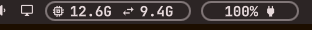

# Patch notes

What each version of the Memory widget added, newest first. What it did
before 22 Oct 2026 is in the [README](../README.md).

## 2026-10-22: Right-click for the GB in use

A right click on the widget shows how many GB of RAM and swap are in use
instead of the percentages; another right click brings the percentages back.
The colours still follow the percentages (orange at 85%, red at 90%), and the
choice is kept across restarts.
How to reach it: right-click the widget, or
`omarchy bar set io.github.stefanoconiglio.memory units GB`.

In the manual: [README](../README.md#memory). Version 1.1.0.
